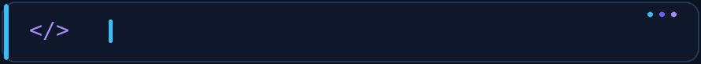
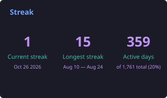
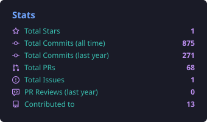
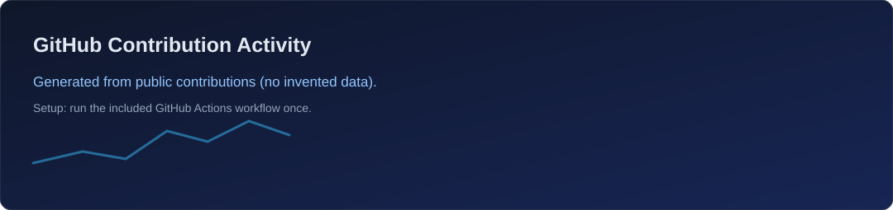

<!-- GitHub profile README: github.com/MohammedNasr51 -->
<!-- Self-hosted header, footer, typing GIF, and scheduled GitHub metrics; technology badges/icons use external image providers. -->

<!-- Local animated GIF: independent of readme-typing-svg.demolab.com uptime -->

  
  
  

---

## 👨‍💻 About Me

I'm **Mohamed Nasr**, a **Front-End Developer** and **Computers and Control Systems Engineering graduate** from **Mansoura University**. I build responsive applications with **React**, **TypeScript**, and modern API-driven architectures.

- 💼 **Huma-volve:** Front-End Developer Intern — collaborated on React/TypeScript products backed by Laravel APIs.
- 🎓 **ITI:** MERN Stack Intensive Training Program — strengthened full-stack JavaScript skills through hands-on team projects.
- 🧩 **DEPI:** Back-End Development training — gained experience with PHP and Laravel.
- ⚡ **What I enjoy:** turning complex workflows into simple interfaces, managing server state, improving UX, and writing reusable components.
- 🌱 **Currently improving:** testing, accessibility, performance, and software architecture.

---

## 🧰 Technologies & Tools

### 🎨 Front-End

### 🔄 State, Forms & APIs

**TanStack Query · Redux Toolkit · Context API · React Router · Axios · REST APIs · Formik · Yup**

### 🗄️ Back-End Experience

### 🛠️ Developer Tools

---

## 🚀 Featured Projects

> Real applications, collaborative engineering, and clear ownership of what I contributed.

<table>
  <tr>
    <td width="50%" valign="top">
      <h3>🎓 <a href="https://github.com/MohammedNasr51/round-5-front-ByWay">ByWay</a></h3>
      
<strong>Online Learning Management System</strong>

      
A multi-role learning platform for students, instructors, and administrators.

      
<strong>My contribution:</strong> Instructor course and lesson management, profile/review integration, revenue-related interfaces, optimistic updates, shared API utilities, and Arabic/English RTL support.

      

        
        
        
      

      
🔗 <a href="https://github.com/MohammedNasr51/round-5-front-ByWay">Repository</a> · <a href="https://github.com/Huma-volve/round-5-front-ByWay/pull/28">My contributions</a>

    </td>
    <td width="50%" valign="top">
      <h3>✈️ <a href="https://github.com/MohammedNasr51/round-5-front-Safarni">Safarni</a></h3>
      
<strong>Travel Booking Platform</strong>

      
A travel application featuring tour discovery, booking interfaces, accommodation, and car-rental flows.

      
<strong>My contribution:</strong> Authentication screens and API integration, Google OAuth, password recovery and OTP flows, validation feedback, and responsive onboarding UI.

      

        
        
        
      

      
🔗 <a href="https://github.com/MohammedNasr51/round-5-front-Safarni">Repository</a> · <a href="https://github.com/Huma-volve/round-5-front-Safarni/pull/3">My contributions</a>

    </td>
  </tr>
  <tr>
    <td width="50%" valign="top">
      <h3>🧠 <a href="https://github.com/MohammedNasr51/Fad-Fadly">Fadfadly</a></h3>
      
<strong>Community & Well-being Platform</strong>

      
A graduation project combining community interaction, blogging, mood and habit tracking, and real-time notifications.

      

        
        
        
      

      
🔗 <a href="https://github.com/MohammedNasr51/Fad-Fadly">View repository</a>

    </td>
    <td width="50%" valign="top">
      <h3>📊 <a href="https://github.com/MohammedNasr51/constledger">ConstLedger</a></h3>
      
<strong>Contract & Finance Management</strong>

      
An ITI team capstone with Node/Express backend services for contract processing, AI-assisted extraction, finance planning, and reporting. The React UI remains a scaffold.

      

        
        
        
      

      
🔗 <a href="https://github.com/MohammedNasr51/constledger">View repository</a>

    </td>
  </tr>
</table>

<strong>📦 Another project — InvenTrack (Inventory Management)</strong>

 

A collaborative inventory application built with **vanilla JavaScript (ES6+)**, **Vite**, and **Bootstrap**, featuring product, supplier, order, and stock-management workflows.

🔗 [View InvenTrack](https://github.com/MohammedNasr51/Inventory-System)

---

## 📈 GitHub Activity

<!-- Generated daily by .github/workflows/profile-metrics.yml and committed to this repository. -->

Stats are generated from real public GitHub contributions by a scheduled GitHub Action. Run the workflow once after uploading to replace the setup placeholders. Private contributions require additional permissions.

---

## 🌱 What I'm Working On

- ⚛️ Building more reliable **React + TypeScript** applications.
- 🧪 Improving **testing, accessibility, and front-end performance**.
- 🧱 Applying cleaner **component architecture and API patterns**.
- 🔌 Exploring practical **full-stack JavaScript** development.

### 🤝 Let's build something useful

**Open to Front-End Developer, React Developer, and junior software engineering opportunities.**

